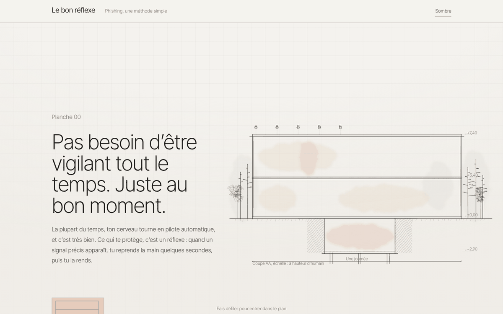
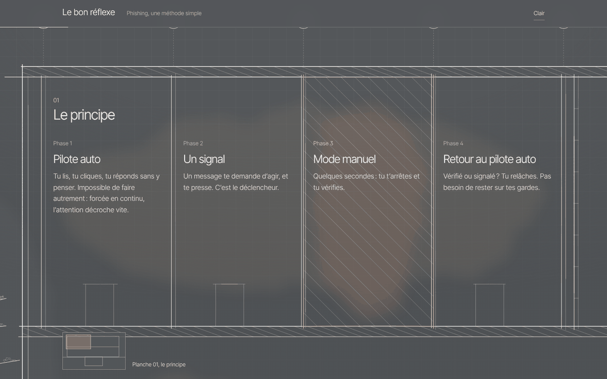
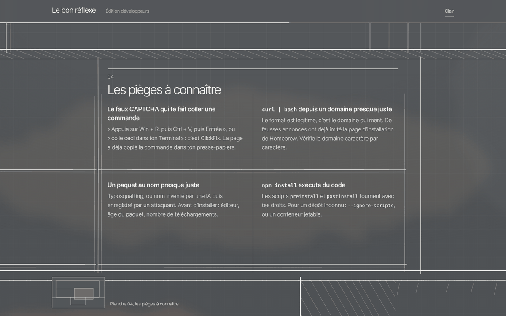

# Le bon réflexe

**Une page de sensibilisation au phishing qui ne demande pas d'être vigilant tout le temps. Juste au bon moment.**

Personne ne peut rester attentif toute la journée, et ce n'est pas le but. On passe la plupart du temps en pilote automatique, et c'est très bien. Ce qui protège, c'est un réflexe : reconnaître les quelques signaux qui doivent faire reprendre la main, vérifier en quelques secondes, puis relâcher.

Le site présente cette méthode à l'intérieur d'une grande coupe d'architecte : on fait défiler la page, et la caméra traverse le bâtiment pièce par pièce, le texte vit dans les éléments qu'on traverse.

**Démo : [lostsh.github.io/archo-phishing](https://lostsh.github.io/archo-phishing/)** (édition développeurs : [dev.html](https://lostsh.github.io/archo-phishing/dev.html))



## Deux éditions

- **`index.html`, grand public** : le principe, les signaux (une demande, sous pression), trois gestes, des astuces peu connues, les risques pour soi, et quoi faire après un clic.
- **`dev.html`, développeurs** : les mêmes réflexes appliqués au quotidien d'un développeur. ClickFix, `curl | bash` depuis un domaine presque juste, typosquatting, scripts `postinstall`, faux tests techniques, phishing de mainteneurs, codes d'appareil, GitHub Actions.





## Points forts

- **Aucune dépendance, aucun build** : trois fichiers statiques (`style.css`, `app.js` et une page HTML par édition).
- **Le dessin est généré en code** : chaque trait est produit par un petit moteur de croquis, avec dépassements, hachures et lavis. Le plan se construit au fil de la visite.
- **Clair et sombre** : papier et graphite, ou planche grise et craie blanche, selon les réglages du système ou au choix.
- **Accessible** : contenu lisible sans JavaScript, ordre de lecture conservé, repli automatique en lecture classique sur mobile et quand l'utilisateur demande moins d'animations.
- **Respect de la vie privée** : pas de traceur, pas de cookie. Seule la police Inter Tight est chargée depuis Google Fonts (voir [Personnaliser](docs/PERSONNALISER.md) pour l'héberger soi-même).

## Utiliser en local

```sh
git clone https://github.com/lostsh/archo-phishing.git
cd archo-phishing
python3 -m http.server 8000
```

Puis ouvrir `http://localhost:8000` (grand public) ou `http://localhost:8000/dev.html` (développeurs). Ouvrir directement les fichiers HTML fonctionne aussi.

## Publier

Le workflow `.github/workflows/pages.yml` publie le site sur GitHub Pages à chaque push sur `main`. Il suffit d'activer GitHub Pages avec la source « GitHub Actions » dans les réglages du dépôt. N'importe quel hébergement statique convient aussi : il suffit de copier les quatre fichiers.

## Adapter à ton organisation

Le canal de signalement, la signature du cartouche, les couleurs, la police ou une nouvelle édition (par exemple pour la finance ou les RH) : tout est décrit dans [docs/PERSONNALISER.md](docs/PERSONNALISER.md). Le fonctionnement du dessin et de la caméra est expliqué dans [docs/ARCHITECTURE.md](docs/ARCHITECTURE.md).

## Structure du dépôt

```
index.html            édition grand public
dev.html              édition développeurs
style.css             styles partagés (thèmes, typographie, blueprint)
app.js                moteur de croquis, dessin, caméra, animations
docs/                 personnalisation, architecture, captures
scripts/              vérifications (typographie, mise en page)
.github/              intégration continue, publication, modèles de tickets
```

## Contribuer

Les propositions de contenu sont les bienvenues, surtout les pièges récents et peu connus. Les règles de rédaction et les vérifications à lancer sont dans [CONTRIBUTING.md](CONTRIBUTING.md). Merci de respecter le [code de conduite](CODE_OF_CONDUCT.md).

Pour une faille de sécurité du site lui-même, voir [SECURITY.md](SECURITY.md). Pour un message suspect reçu, ce n'est pas le bon endroit : préviens ton équipe sécurité.

## Licence

[MIT](LICENSE), © Yohann Vernhes. Tu peux réutiliser le code et les textes, y compris dans ton organisation, en conservant la mention de copyright.

---

## In English

*Le bon réflexe* ("the right reflex") is a French phishing awareness page built on one idea: you don't need to be vigilant all the time, only at the right moment. Scrolling moves a camera through a single hand-drawn architectural section, and the content lives inside the rooms. There are two editions, general public (`index.html`) and developers (`dev.html`). It is a dependency-free static site, MIT licensed. Translations are welcome: see [CONTRIBUTING.md](CONTRIBUTING.md).
